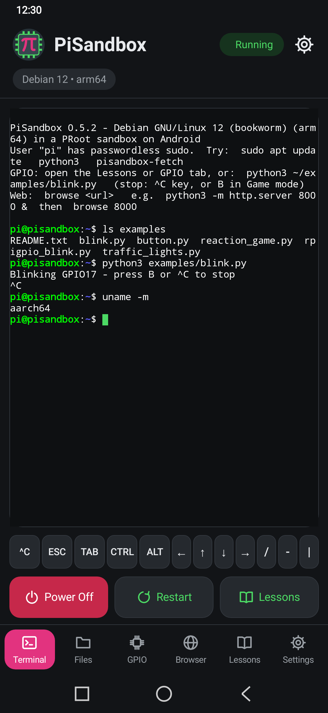
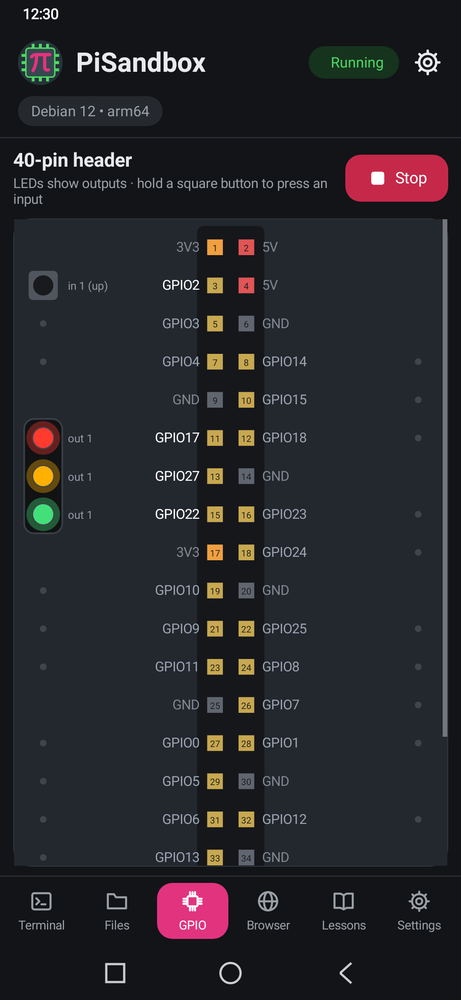
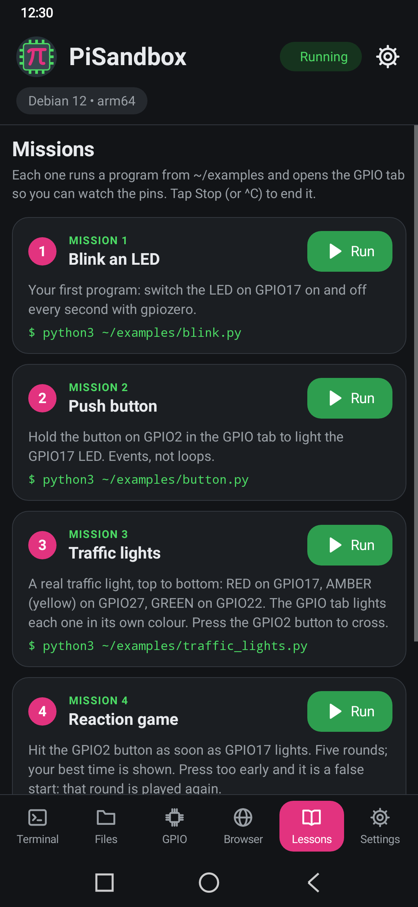
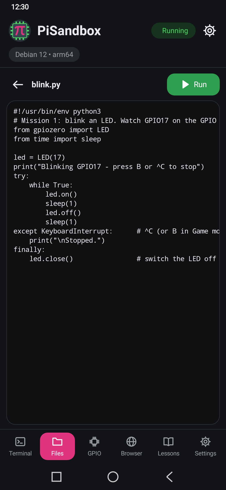
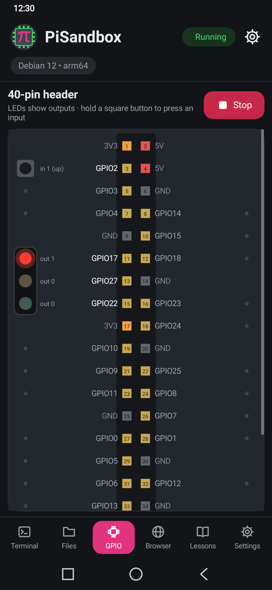
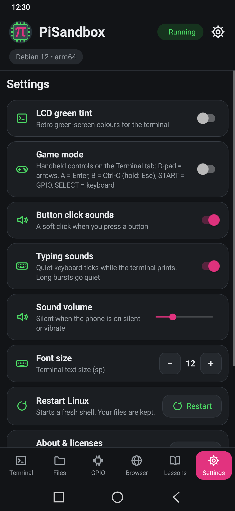
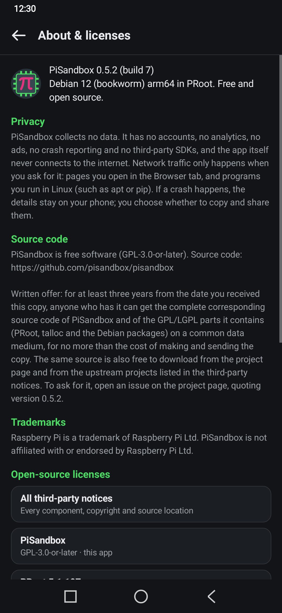

# PiSandbox

**A pocket Linux computer for learning: Debian 12 + Python + a virtual GPIO header, running inside an Android app.**
No root, no account, no internet needed after install, and no data collected.

**[Website](https://pisandbox.github.io/pisandbox/)** · **[Download the latest release](https://github.com/pisandbox/pisandbox/releases/latest)** · [Privacy policy](https://pisandbox.github.io/pisandbox/privacy.html)

PiSandbox runs a real **Debian 12 "bookworm" arm64** system on your phone's own CPU (under PRoot, no emulator),
set up like the Linux on a hobby single-board computer: user `pi` with `sudo`, the `pi@pisandbox:~ $` prompt,
Python 3.11 with pip/venv, `apt`, and a board identity so tutorials that check "which board am I on?" work.
Python GPIO code (`gpiozero`, `RPi.GPIO`, the `gpio` command) drives an **on-screen 40-pin header** with coloured
LEDs and press-and-hold buttons. Five beginner lessons are built in.

| Terminal | GPIO: traffic lights | Lessons | Files |
|---|---|---|---|
|  |  |  |  |

| GPIO header | Settings | About & licenses | Start-up |
|---|---|---|---|
|  |  |  |  |

(Screenshots are rendered by the test suite at a 1080 × 2340 phone size.)

## Features
* **Terminal** with an extra-keys row (^C, Esc, Tab, latching Ctrl/Alt, arrows) and an optional handheld **Game mode**.
* **GPIO tab**: a 40-pin header that shows what your Python program does — outputs light LEDs, inputs are buttons you hold.
  LEDs can have their own colour (`gpio -g color 17 red`, `pisandbox_gpio.led_color(…)`); gpiozero `TrafficLights`
  shows red, amber and green automatically.
* **Lessons**: blink an LED, read a button, traffic lights, a reaction game, PWM fading. One tap runs them.
* **Files**: browse your home folder, read text files, run `.py` files.
* **Sounds**: a soft click on buttons and quiet typing ticks while the terminal prints (Settings: both can be
  switched off, volume slider; silent when the phone is on silent or vibrate).
* **Browser**: open the web server you just started in Linux (`python3 -m http.server 8000`, then type `8000`).
* Keeps running in the background (a notification with **Power off**), survives rotation, dark mode and split screen.
* **Private by design**: no analytics, no ads, no crash reporting, no third-party SDKs — see [PRIVACY.md](PRIVACY.md) (also on the [website](https://pisandbox.github.io/pisandbox/privacy.html)).

## Install (Android)
Requires Android 8.0+ on a 64-bit ARM phone and about **600 MB free** for the first start (Debian is unpacked once,
~20–60 s; nothing is downloaded).

1. On the phone, open the [latest release](https://github.com/pisandbox/pisandbox/releases/latest) and download
   `pisandbox-<version>-release.apk`. Optional: compare its SHA-256 with the `.sha256` file next to it.
2. Open the downloaded file (from the browser's downloads or a file manager such as My Files).
3. Android asks to **install unknown apps**: tap **Settings**, switch on **Allow from this source** for that browser
   or file manager, go back and tap **Install**. (Or beforehand: Settings → Apps → Special app access →
   **Install unknown apps** → your browser → Allow. On Samsung, also turn off Settings → Security and privacy →
   **Auto Blocker** while installing.) You can switch the permission off again afterwards.
4. If Play Protect warns about an unknown or older-Android app, choose **More details → Install anyway**. PiSandbox
   targets Android 9 APIs on purpose: newer targets forbid running the Linux programs it unpacks.
5. Open PiSandbox. From a computer instead: `adb install pisandbox-<version>-release.apk`.

Release APKs are signed with the certificate SHA-256
`D2:3F:D5:39:31:A1:63:38:0A:D9:90:77:77:39:6D:17:C4:E1:E7:48:C1:0C:E3:A4:26:CE:27:E3:3D:F5:8B:C8`
(`apksigner verify --print-certs <apk>`). **Had a debug/test build?** Android cannot update a debug-signed install
with a release-signed APK ("App not installed" / "package conflicts"): copy anything you want to keep out of
`/home/pi`, uninstall once, then install. Details: [docs/INSTALL.md](docs/INSTALL.md).

## Build from source
Linux x86_64 host, JDK 17, Android SDK 35 + NDK; no root.
```bash
./scripts/fetch-assets.sh          # pinned PRoot libs, the Linux rootfs (see below) and the GPIO runtime overlay
./gradlew clean assembleDebug      # app/build/outputs/apk/debug/
./gradlew assembleRelease          # needs your own keystore, see docs/RELEASE.md
./gradlew testDebugUnitTest lint   # Robolectric UI-flow, installer, GPIO and splash tests; lint must be clean
SIM_ANDROID=1 ./scripts/host-verify.sh   # boots the app's exact Linux setup on the host (proot + qemu-aarch64)
```

**The Linux rootfs (73 MB) is not in git.** The APK bundles `pisandbox-rootfs-bookworm-arm64.tar.xz`, a customised
Debian 12 image. Git holds the recipe instead: `scripts/build-rootfs.sh`, `rootfs/` (package list, overlay,
`customize.sh`), the exact package manifest `rootfs/manifest-bookworm-arm64.txt` and the tarball's SHA-256. The
pinned base image comes from `scripts/assets.lock`. `fetch-assets.sh` gets the tarball in one of three ways
(`PISANDBOX_ROOTFS=…`):

| Mode | What it does |
|---|---|
| `auto` (default) | uses `build/rootfs/` if present, else downloads the prebuilt tarball, else builds it |
| `prebuilt` | downloads `pisandbox-<version>-rootfs-bookworm-arm64.tar.xz` from the GitHub release and checks the SHA-256 pinned in `scripts/assets.lock`: byte-identical to the APK's |
| `build` | runs `scripts/build-rootfs.sh` (~4 min, needs internet; installs the current Debian package versions, so the result is equivalent but not byte-identical) |

The public source link shown in the app is set in one place, `pisandbox.projectUrl` in `gradle.properties`.
`scripts/set-repo-owner.sh <github-owner>` sets it (plus the same link in docs, site and the rootfs download) and
rebuilds. How the sandbox works: [docs/TECHNICAL.md](docs/TECHNICAL.md). Releasing: [docs/RELEASE.md](docs/RELEASE.md).

## License
PiSandbox is free software under the **GNU General Public License v3.0 or later** ([LICENSE](LICENSE)).
Why GPL and not Apache-2.0: [docs/LICENSING.md](docs/LICENSING.md). It bundles third-party software under their own
licences (PRoot GPL-2.0+, talloc LGPL-3.0+, Debian packages, Termux terminal libraries Apache-2.0, …):
**Third-party notices:** [THIRD_PARTY.md](THIRD_PARTY.md), [NOTICE](NOTICE) and
[legal/THIRD_PARTY_NOTICES.txt](legal/THIRD_PARTY_NOTICES.txt) (licence texts in [legal/licenses/](legal/licenses/)).
Every licence text is also in the app (Settings → About & licenses). Debian package copyrights are inside the Linux
system under `/usr/share/doc/*/copyright`.

Raspberry Pi is a trademark of Raspberry Pi Ltd. PiSandbox is not affiliated with or endorsed by Raspberry Pi Ltd.
Debian is a registered trademark of Software in the Public Interest, Inc. PiSandbox is not an official Debian product.

## Feedback
Bug reports and questions: [issues](https://github.com/pisandbox/pisandbox/issues). Tester guide:
[docs/TESTERS.md](docs/TESTERS.md). Changes: [CHANGELOG.md](CHANGELOG.md).
